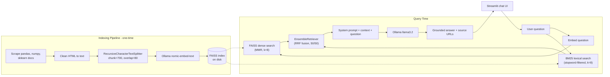

# RAG-Based AI Teaching Assistant: Intro to Python Data Science

A fully-local Retrieval-Augmented Generation (RAG) assistant that answers
student questions about **pandas**, **NumPy**, and **scikit-learn** strictly
from the official documentation it has indexed — so it cites sources instead
of hallucinating.

> Built with **LangChain** (modern LCEL `create_retrieval_chain`), **Ollama**
> (`llama3.2` + `nomic-embed-text`), **FAISS**, and **Streamlit**. No API
> keys, no cloud calls, runs end-to-end on a laptop.

---

## Architecture



## Why this exists

A vanilla LLM, asked something like _"What does the `chunksize` parameter of
`pd.read_csv` do?"_, will often confidently invent details. This project
demonstrates the standard fix: ground the model in a curated corpus, retrieve
the most relevant chunks at query time, and force the model to answer **only
from those chunks** with citations. The `eval/` script quantifies the
difference.

## Prerequisites

1. **Python 3.10+**
2. **Ollama** installed and running locally — see <https://ollama.com/download>
3. Pull the two models the assistant uses:

   ```bash
   ollama pull llama3.2
   ollama pull nomic-embed-text
   ```

4. Make sure the Ollama server is up (it auto-starts on most installs):

   ```bash
   ollama serve   # only needed if it isn't already running
   ```

## Quickstart

```bash
# 1. Install Python dependencies
python -m venv .venv
.venv\Scripts\activate          # PowerShell on Windows
# source .venv/bin/activate      # macOS / Linux
pip install -r requirements.txt

# 2. Build the knowledge base (scrape -> chunk -> embed -> FAISS).
#    First run takes ~2-5 min depending on your machine; HTML is cached.
python scripts/build_index.py

# 3. Launch the chat UI
streamlit run app.py
```

You can also ask a one-off question from the CLI:

```bash
python scripts/ask.py "How does NumPy broadcasting work between (3,1) and (1,4)?"
```

## Project layout

```
.
├── app.py                  # Streamlit chat UI
├── config.py               # Paths, model names, chunk sizes (env-overridable)
├── requirements.txt
├── .env.example
├── data/
│   ├── raw/                # Cached HTML (gitignored)
│   └── processed/          # Cleaned markdown w/ source_url front-matter
├── vectorstore/            # FAISS index (committed for deploy)
├── .streamlit/
│   └── secrets.toml.example  # Template for Streamlit Cloud secrets
├── src/
│   ├── llm.py              # LLM/embeddings factories (ollama | groq | hf_endpoint)
│   ├── scraper.py          # Curated URL list, polite fetcher, HTML->md
│   ├── ingest.py           # Load -> Split -> Embed -> FAISS.save_local
│   ├── retriever.py        # Hybrid BM25 + FAISS(MMR) ensemble retriever
│   └── chain.py            # create_retrieval_chain w/ grounded system prompt
├── scripts/
│   ├── build_index.py      # End-to-end pipeline runner
│   └── ask.py              # CLI Q&A
└── eval/
    ├── questions.yaml      # 12 hand-crafted Q&A pairs w/ expected keywords
    ├── evaluate.py         # Baseline (no RAG) vs RAG keyword-recall scoring
    └── results.md          # Auto-generated comparison report
```

## The system prompt that does the grounding

```text
You are a teaching assistant for Intro to Python Data Science.
Answer the student's question using the retrieved context below.
Synthesize across the snippets and quote specific terms from them.
Cite the source URL after each fact in square brackets, like
[https://...].

If the context truly does not address the question, say so plainly
and suggest where the student might look. But if the context
contains relevant material, do NOT refuse -- give the best answer
the context supports.

Context:
{context}
```

## Evaluation: RAG vs vanilla LLM

`eval/evaluate.py` runs each question in `eval/questions.yaml` through
**both** a vanilla `llama3.2` call (no context) and the full RAG chain,
then measures keyword recall against an expected-keywords list per question:

```bash
python eval/evaluate.py
```

This generates `eval/results.md` with a side-by-side per-question comparison
and an aggregate summary table:

| Metric | Baseline (no RAG) | RAG |
|---|---|---|
| Avg keyword recall (12 questions) | 86.1% | **90.3%** |
| Absolute improvement | — | **+4.2 pts** |
| Wins / ties / losses | — | 3 / 8 / 1 |

The biggest individual gains came from questions that hinge on a rare
identifier (e.g. _StratifiedKFold_, _chunksize_, _make_pipeline_), where
the lexical half of the hybrid retriever locks onto the right doc page that
pure embedding similarity sometimes glosses over.

(Numbers vary slightly between runs — re-run the eval after any
chunking/model/prompt change.)

## Configuration

Copy `.env.example` to `.env` and override anything:

| Variable | Default | Purpose |
|---|---|---|
| `LLM_PROVIDER` | `ollama` | `ollama` (local, GPU) or `groq` (cloud, free tier) |
| `EMBED_PROVIDER` | `ollama` | `ollama` (local) or `hf_endpoint` (HF Inference) |
| `OLLAMA_HOST` | `http://localhost:11434` | Ollama server URL |
| `OLLAMA_LLM_MODEL` | `llama3.2` | Local generation model |
| `OLLAMA_EMBED_MODEL` | `nomic-embed-text` | Local embeddings model |
| `GROQ_API_KEY` | _(unset)_ | Free key from <https://console.groq.com> |
| `GROQ_LLM_MODEL` | `llama-3.1-8b-instant` | Cloud generation model |
| `HF_TOKEN` | _(unset)_ | Free token from <https://huggingface.co/settings/tokens> |
| `HF_EMBED_MODEL` | `nomic-ai/nomic-embed-text-v1.5` | **Same** weights Ollama bundles — index is cross-compatible |
| `CHUNK_SIZE` | `700` | Characters per chunk |
| `CHUNK_OVERLAP` | `80` | Overlap between adjacent chunks |
| `RETRIEVAL_K` | `8` | Top-k chunks retrieved per question |
| `RETRIEVAL_FETCH_K` | `20` | Candidates fetched before MMR re-rank |
| `RETRIEVAL_SEARCH_TYPE` | `mmr` | `similarity` or `mmr` for diversity |
| `RETRIEVAL_HYBRID` | `true` | Ensemble BM25 (lexical) + FAISS (dense) |
| `RETRIEVAL_BM25_WEIGHT` | `0.5` | 0.0 = pure FAISS, 1.0 = pure BM25 |

## Deploy to Streamlit Community Cloud (free)

The app supports two backends through a small provider abstraction in
`src/llm.py`. Locally it runs `llama3.2` on your GPU via Ollama; on
Streamlit Cloud it transparently swaps to **Groq** (`llama-3.1-8b-instant`)
for generation and **HuggingFace Inference** for the
`nomic-embed-text-v1.5` query embeddings — the *same* model the FAISS
index was built with, so **no re-indexing is needed**. Both cloud
providers have free personal tiers.

1. **Get free credentials** (each takes ~30 seconds):
   - Groq API key: <https://console.groq.com/keys>
   - HuggingFace token (read-only): <https://huggingface.co/settings/tokens>

2. **Push to GitHub**, including the `vectorstore/` folder (~10 MB,
   committed by design — saves the cloud deploy from running the
   ~5 min scrape+embed step on cold start):

   ```bash
   git init
   git add .
   git commit -m "RAG teaching assistant"
   git remote add origin https://github.com/<you>/<repo>.git
   git push -u origin main
   ```

3. **Create the Streamlit app**:
   - Go to <https://share.streamlit.io>, click **New app**.
   - Pick the GitHub repo, set the entrypoint to `app.py`, click **Deploy**.

4. **Add secrets** (App settings -> Secrets) — paste the contents of
   [`.streamlit/secrets.toml.example`](.streamlit/secrets.toml.example)
   and fill in your real `GROQ_API_KEY` and `HF_TOKEN`. The shim at the
   top of `app.py` mirrors `st.secrets` into `os.environ` before any
   other module imports, so the same `os.getenv`-based config works
   locally and in the cloud.

5. **Done** — Streamlit auto-redeploys on every `git push`. Your live
   URL will be `https://<repo>-<hash>.streamlit.app`.

The app caption updates to show which providers are wired up
(_LLM: Groq · `llama-3.1-8b-instant` · embed: HF · `nomic-ai/...`_) so
you can tell at a glance which backend is in use.

## Extending the corpus

Add URLs to the `SOURCES` tuple in [`src/scraper.py`](src/scraper.py), then
re-run `python scripts/build_index.py`. Already-cached HTML in `data/raw/`
is reused for free.

## Notes & limitations

- **Curated, not exhaustive** — the scraper hits a hand-picked subset of
  pages so the demo is reproducible in a few minutes. Production use would
  expand the URL list (or swap to sitemap-based crawling).
- **Keyword-recall is a proxy** — it's a fast, deterministic metric; for a
  production system you'd add a judge-LLM (e.g. RAGAS) for faithfulness and
  context-precision scores.
- **Polite scraping** — single-threaded, 1 request/sec, real `User-Agent`,
  and HTML responses are cached so re-runs make zero network requests.
