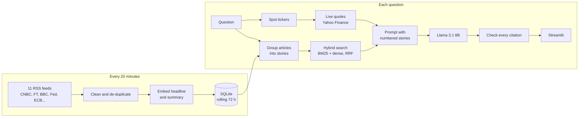

# Market Briefing: a cited chat assistant for the last 48 hours of financial news

Ask what moved markets and why, and get an answer built only from the past
48 hours of financial news, with every claim linked to the article it came
from. Prices come from a live market-data feed, never from the model.

- **Briefing:** the five biggest stories of the last 24 hours, written up with citations.
- **Ask:** questions like *"Why did Intel stock fall?"* or *"What did the ECB decide?"*, with follow-ups.
- **Says when it doesn't know:** questions the news doesn't cover get "Nothing in the last 48 hours of coverage addresses that." instead of a guess.
- **No advice:** "Should I buy...?" is caught in code and answered with what was reported, never a recommendation.

Built with Python, LangChain, Ollama (Llama 3.1 8B) or Groq, fastembed, BM25, SQLite and Streamlit.

## Why retrieval matters here

A language model's knowledge stops at its training cut-off, so it cannot know
what happened yesterday. Asked closed-book, it either refuses or invents an
answer. That makes recent news the clearest possible case for retrieval: the
model only has to read and cite, and the evaluation below measures how well
it does that.

## How it works



1. **Ingest** (`src/feeds.py`, `src/store.py`). Eleven free RSS feeds are read in parallel. Only the headline, the feed's own summary and the link are stored, never the article, so every answer sends readers back to the publisher. Tracking parameters, inline CSS and boilerplate are stripped, and items older than the 72-hour retention window are skipped.
2. **Group into stories** (`src/stories.py`). The same event is reported by five outlets within an hour. Articles whose *headlines* are at least 0.8 similar become one story, unless they name different tickers. Grouping on headlines rather than summaries matters: a live blog whose summary rounds up the whole day matched every story it mentioned.
3. **Search** (`src/retriever.py`). BM25 catches exact names ("Okta", "Series I bond"); embeddings catch paraphrases ("chip stocks" finds "semiconductor shares"). The two rankings are merged with reciprocal-rank fusion. Abbreviations are expanded ("ECB" also searches "European Central Bank"), and stories below a similarity floor never reach the model, which is what lets it say "nothing reported".
4. **Quote** (`src/market.py`). Tickers and company names in the question ("Intel", "$AMD", "the S&P 500") are looked up live. The model sees prices only in a labelled MARKET DATA block and is told not to state any other numbers.
5. **Answer and check** (`src/chain.py`). Stories are numbered `[1]`, `[2]`... and prices are `[M]`. After the answer is generated, every citation is checked against what was actually supplied, and the app flags any that point at nothing.

A few hundred headlines fit in one matrix, so search is an exact matrix-vector product. An approximate index (FAISS, HNSW) would add a dependency and buy nothing at this size.

## Evaluation

The news changes every few minutes, so the evaluation runs on a frozen
snapshot (`eval/snapshots/2026-10-31.db`: 137 stories, 159 articles) with 40
hand-written questions (`eval/questions.yaml`):

- **28 answerable**, each with the story that answers it and the facts the answer must contain.
- **8 uncovered:** plausible questions the snapshot does not cover (Toyota earnings, the Bank of Japan, an Nvidia stock split...). The right answer is "nothing was reported".
- **4 advice requests** ("Should I buy Intel stock now?").

### Retrieval: does the right story reach the model?

| Configuration | Right story ranked 1st | In top 3 | In context (top 8) | MRR | Stories passed on uncovered questions |
|---|---|---|---|---|---|
| Dense only | 26/28 | 28/28 | 28/28 | 0.96 | 3.0 |
| BM25 only | 26/28 | 27/28 | 28/28 | 0.95 | 7.8 |
| Hybrid + recency boost (w = 0.4) | 21/28 | 26/28 | 28/28 | 0.85 | 3.0 |
| **Hybrid (the app)** | **27/28** | **28/28** | **28/28** | **0.98** | **3.0** |

What the evaluation changed:

- **The recency boost was removed.** It seemed obviously right for news: rank fresher stories higher. Measured, it pushed correct day-old stories down (hit@1 from 27 to 21). Even a 5% weight cost two first places, because fused scores sit so close together that any multiplier reorders them. The 48-hour window already keeps everything recent, so search no longer uses a boost. The briefing still ranks by recency, because "the most important stories of the last 24 hours" really is about freshness.
- **Keyword matches no longer bypass the similarity floor.** Hybrid search first passed 6.6 stories to the model on uncovered questions, double the dense-only figure, because weak keyword hits slipped through. Every correct story scored at least 0.66 cosine similarity, and the keyword-only noise scored 0.45-0.64. A keyword match now lifts only the relative cut-off, which brought the noise down to 3.0 with no loss of recall.

### End to end

Llama 3.1 8B on a laptop GPU, temperature 0, live quotes switched off so the run is repeatable:

| Check | With retrieval | Same model, closed book |
|---|---|---|
| Answerable: every expected fact in the answer | **28/28** | 8/28 |
| Answerable: cites the story that holds the answer | **28/28** | - |
| Answerable: wrongly says nothing was reported | 0/28 | - |
| Uncovered: says nothing was reported | **8/8** | - |
| Advice: caught, and no recommendation in the answer | **4/4** | - |
| Any answer citing a source it was not given | 0/40 | - |
| Any answer stating a number not found in its sources | 0/40 | - |

Closed book, the model admitted it lacked current information only once in 28
questions. The other 27 times it answered confidently, usually with stale or
invented facts. Retrieval is what makes this usable.

Reading the answers, not just the scores, found three problems the first version of the metrics missed:

- **Invented "related stories".** After correctly saying "nothing was reported", the model was allowed to point to the closest related story, and used that to make one up: a Netflix quote cited as `[1]` when it had been given no stories at all. Now the model isn't called when search finds nothing, and after "nothing reported" only sentences citing a supplied story are kept.
- **An invented figure.** One GDP answer added "better than the expected 2.8%", a number in none of its sources. Every answer is now checked for numbers that appear nowhere in its sources, and the app shows a warning under any it finds. The evaluation counts them too.
- **A guessed year.** Story dates had no year, so the model guessed one. Dates now include it.

Full per-question results: [`eval/results.md`](eval/results.md).

**Caveats.** 40 questions on one day's news is a small sample, so read the
counts, not the percentages. The similarity floor and the recency decision
were tuned on this same set. The honest next step is a second snapshot from a
different day, scored without re-tuning. Keyword checks ("does the answer
contain 2.5%?") can miss a correct paraphrase. The number check confirms that
a figure appears in the sources, not that it is used correctly: one I-bond
answer attached the date of the snapshot to the rate period, and the check
passed it. Zero invented figures in this run is a result for this run, not a
guarantee, which is why the check also runs live in the app.

## Run it

Requires Python 3.10+ and, for local generation, [Ollama](https://ollama.com/download).

```bash
python -m venv .venv
.venv\Scripts\activate            # Windows; macOS/Linux: source .venv/bin/activate
pip install -r requirements.txt
ollama pull llama3.1:8b

streamlit run app.py              # fetches the feeds on first load
```

Other entry points:

```bash
python scripts/ask.py "Why did Intel stock fall?"   # one question from the terminal
python scripts/refresh.py                           # fetch feeds (for a scheduled job)
python scripts/snapshot.py 2026-11-07               # freeze today's news for evaluation
python eval/evaluate.py                             # full evaluation (about 7 min on an RTX 2080)
python eval/evaluate.py --no-llm                    # retrieval only (seconds)
```

Settings live in `.env` (copy `.env.example`). The ones you're most likely to change:

| Variable | Default | Purpose |
|---|---|---|
| `LLM_PROVIDER` | `ollama` | `ollama` (local GPU) or `groq` (cloud, free tier) |
| `OLLAMA_LLM_MODEL` | `llama3.1:8b` | Local model |
| `GROQ_API_KEY` / `GROQ_LLM_MODEL` | - / `llama-3.1-8b-instant` | Cloud model |
| `SEARCH_WINDOW_HOURS` | `48` | How far back answers can draw on |
| `REFRESH_MINUTES` | `20` | How stale the feeds may get before the app re-reads them |
| `SEC_USER_AGENT` | empty | Set to `"Name email"` to add SEC 8-K filings |

## Deploy to Streamlit Community Cloud

1. Push the repo to GitHub.
2. At <https://share.streamlit.io>, create an app with `app.py` as the entry point.
3. In **App settings > Secrets**, paste `.streamlit/secrets.toml.example` with a real `GROQ_API_KEY` ([free key](https://console.groq.com/keys)).

Embeddings run inside the app, so no second API key is needed. The app fetches the feeds on first load and keeps them fresh while people use it.

## Limitations

- **Headlines and summaries only.** The model sees what the feed publishes, usually a sentence or two, not the article. That is enough for "what happened", not for detailed analysis.
- **Free feeds.** Coverage is broad but not complete, and Yahoo Finance prices can be delayed.
- **An 8B model.** It sometimes skips a rule, such as citing every sentence. That's why advice detection, price figures and citation checks are done in code rather than left to the prompt.
- **Not investment advice.** It reports what was published.
